# Declassified UFO Files

An interactive research dashboard for the U.S. Department of War [PURSUE](https://www.war.gov/ufo/) UAP/UFO file releases. The pipeline downloads every released document, image, video and audio file, transcribes it, writes a page-cited deep analysis report for each file, links related incidents across files, and publishes a static site.

**[View the live dashboard →](https://ufo-analysis.rittmuller.com/)**

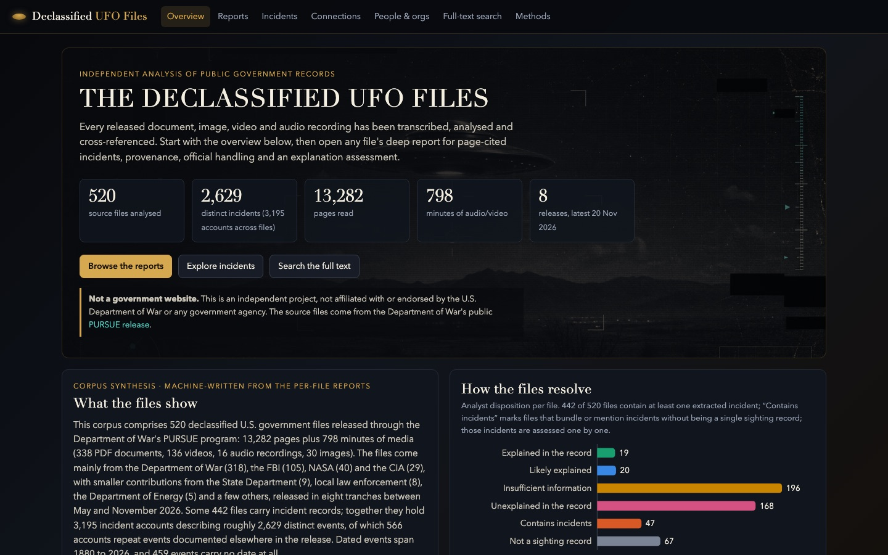

This is an independent project. It is not affiliated with, endorsed by, or operated by any government agency. Summaries, classifications and assessments are machine-generated research aids; check the cited page of the original file before quoting or relying on a claim.

## Contents

- [What's on the site](#whats-on-the-site)
- [How it works](#how-it-works)
- [Setup](#setup)
- [Running](#running)
- [Viewing and deploying](#viewing-and-deploying)
- [MCP server](#mcp-server)
- [Repository layout](#repository-layout)
- [What the reports contain](#what-the-reports-contain)
- [Data and publishing notes](#data-and-publishing-notes)

## What's on the site

| View | What it shows |
|---|---|
| **Overview** | Corpus synthesis, headline figures, disposition, explanation, observation-mode and shape breakdowns, an incident timeline and map, cross-cutting findings and a data-quality panel. |
| **Reports** | One deep report per released file: summary and key points with page citations, every incident in the file, the record's own conclusion kept separate from a machine assessment, provenance and redaction details, people and entities, related reports, and a page-by-page source-text reader. |
| **Incidents** | Every extracted observation account, filterable (date, place, shape, sensors, status, explanation, Hynek class, documentation strength, agency) and exportable to CSV or JSON. Repeat accounts of one event can be collapsed to one row per event. |
| **Connections** | A rotatable 3D network of incidents linked by explicit factors (same time and place, matching description, the same account in another file, a named person, a mission), with clusters of related events and the reason for every link. |
| **People & orgs** | People, organisations, programmes and equipment named across the files, each linked to the reports that mention them. |
| **Full-text search** | Search over the extracted text of every page and transcript, opening the hit at the right page of its report. |
| **Methods** | How the data was produced, the consistency rules, scales and caveats. |

Every report also has a plain, crawlable HTML page at `/files/<id>/` that links into the interactive report.

<table>
<tr>
<td width="50%"><a href="docs/screenshots/overview-timeline-map.jpg">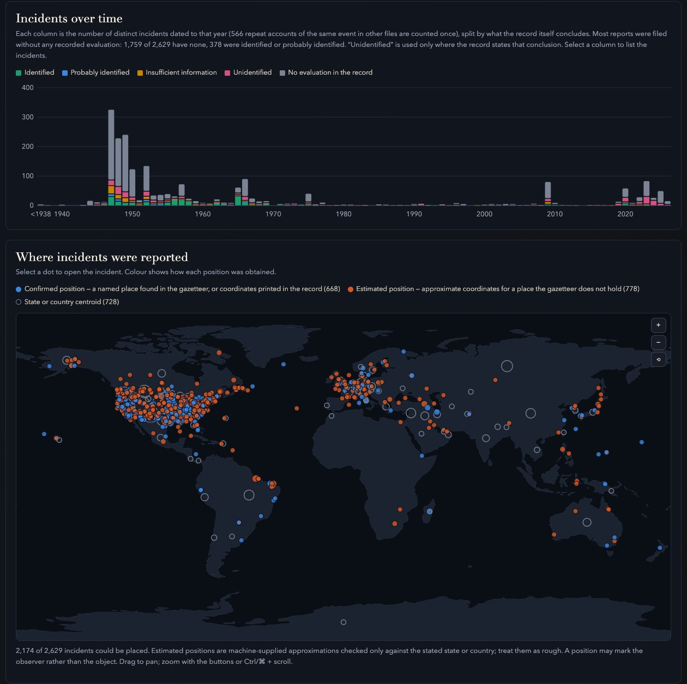</a><br><sub><b>Overview</b> – incidents over time and where they were reported, coloured by how each position was obtained.</sub></td>
<td width="50%"><a href="docs/screenshots/connections.jpg">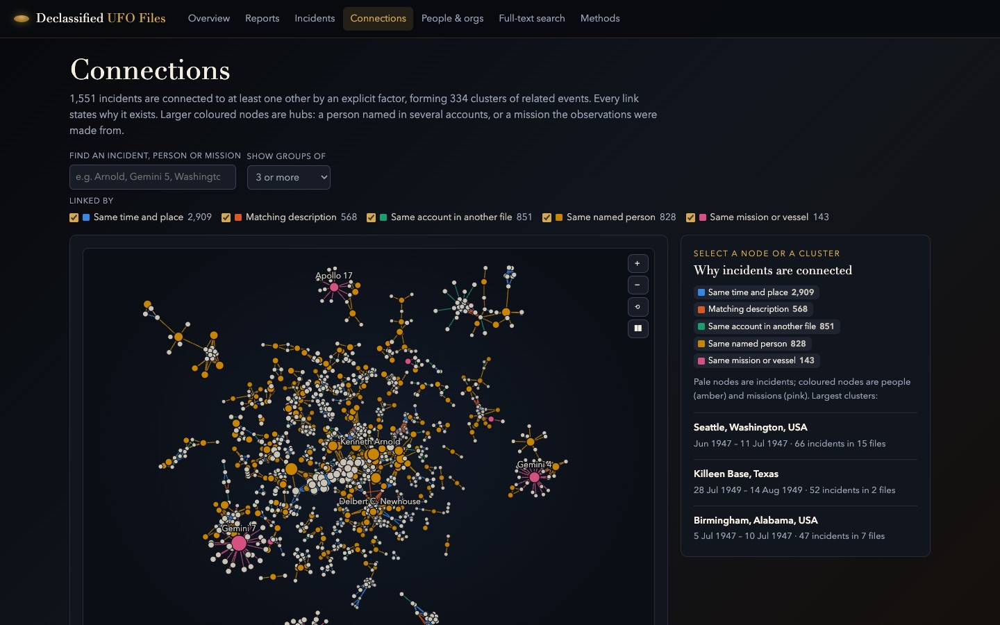</a><br><sub><b>Connections</b> – incidents linked by explicit factors, with people and missions as hub nodes.</sub></td>
</tr>
<tr>
<td width="50%"><a href="docs/screenshots/reports.jpg">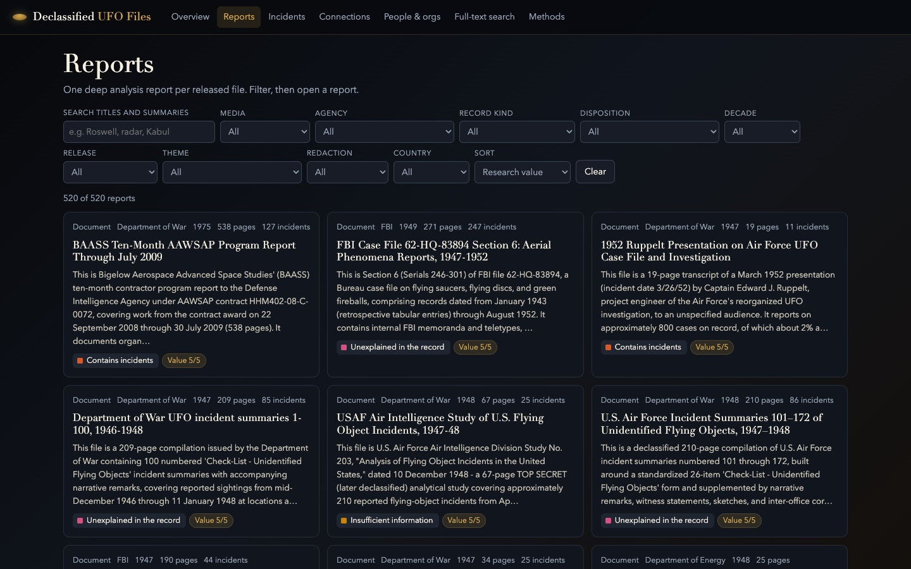</a><br><sub><b>Reports</b> – one deep report per file, filterable by media, agency, kind, disposition, release, theme and more.</sub></td>
<td width="50%"><a href="docs/screenshots/report.jpg">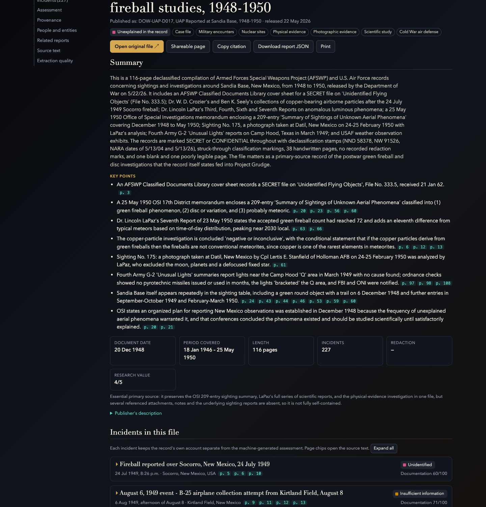</a><br><sub><b>Deep report</b> – summary and key points with page chips that open the source text, then every incident in the file.</sub></td>
</tr>
<tr>
<td width="50%"><a href="docs/screenshots/incidents.jpg">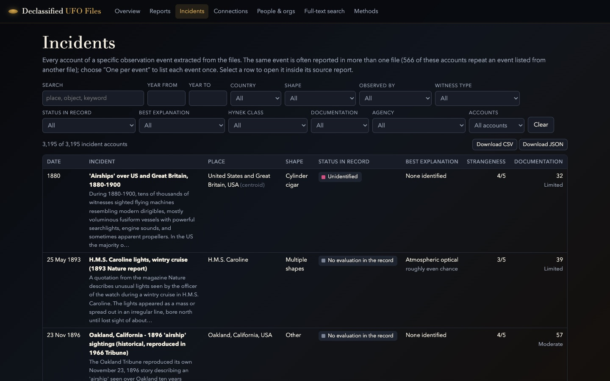</a><br><sub><b>Incidents</b> – every account in one filterable, exportable table.</sub></td>
<td width="50%"><a href="docs/screenshots/search.jpg">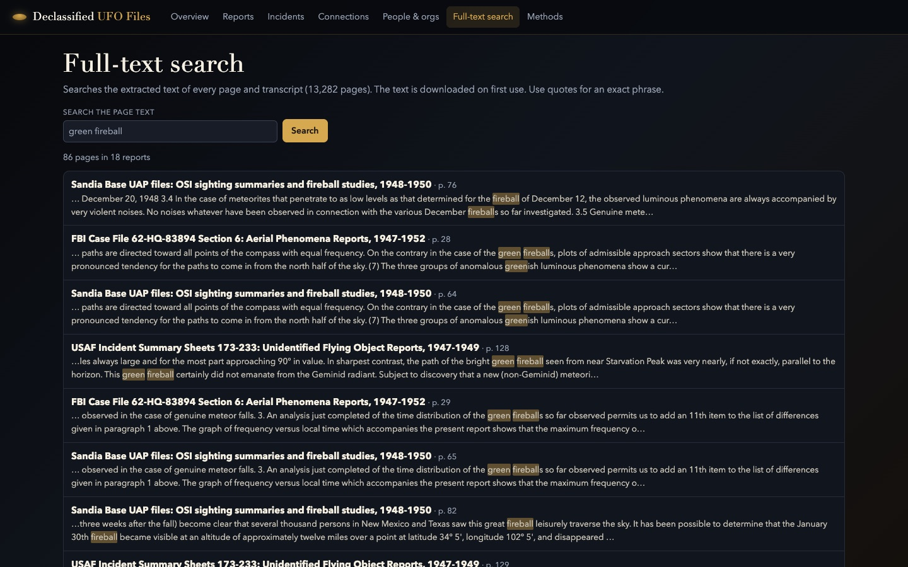</a><br><sub><b>Full-text search</b> – every page and transcript, with the matching passage and page number.</sub></td>
</tr>
</table>

## How it works

The pipeline is a Python package (`ufo_pipeline`) with five resumable stages. Each stage reads the previous stage's cache under `data/` and writes its own; only `build` writes into the published site folder.

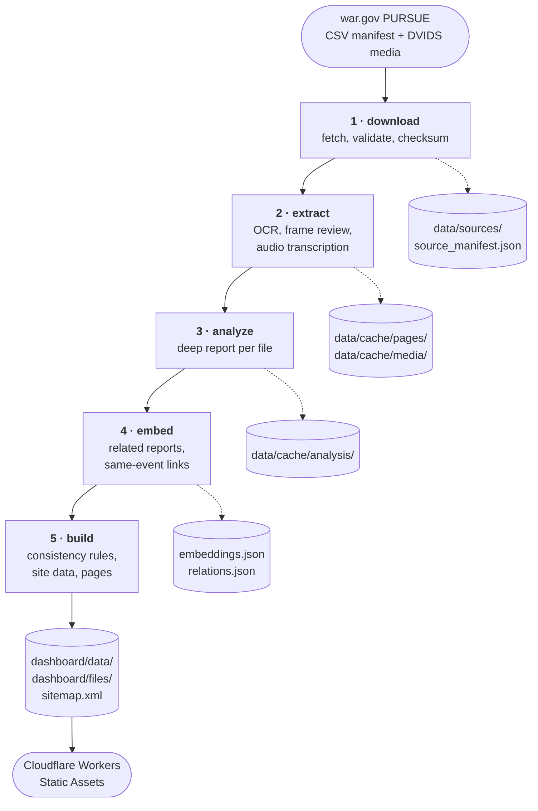

| Stage | What it does | Models |
|---|---|---|
| `download` | Reads the war.gov CSV manifest and DVIDS metadata (choosing the highest-quality MP4), downloads each file to a temp name, validates it (HTTP status, size, file signature) and records size and SHA-256 in the manifest. One bad row never aborts the run; partial runs merge into the manifest rather than replacing it. | – |
| `extract` | Every scanned PDF page and image is transcribed by a vision model, which also notes handwriting, redactions, markings and pictures. Born-digital pages use their native text. Video is sampled into frames that are described together; audio is transcribed in 60-second chunks, plus official captions where available. Degenerate or looping OCR output is detected and rejected. | Remote → local → Tesseract → embedded text layer (OCR). Local → remote (audio). |
| `analyze` | Splits each file's text into page-aligned parts (nothing is sampled), extracts constituent records, incidents, entities and key passages from each part, then writes the file-level report. Quotes are checked against page text; dates and places are normalised; a documentation-strength score is computed. | Remote → local |
| `embed` | Embeds every report and every incident. Links each report to its most similar reports, and links incidents in different files that describe the same event. | Local |
| `build` | Applies fixed consistency rules to the model's labels, groups repeat accounts of the same event, builds the connections graph, then writes the site data – a compact index, one JSON per report (loaded on demand), full-text search shards, frame thumbnails, static per-report pages, sitemap – and a corpus synthesis written from per-file summaries and corpus statistics. | Remote → local |

### Model fallback chains

Every model call goes through an OpenAI-compatible client (`ufo_pipeline/llm.py`). Each task has an ordered chain of endpoints. A transient error is retried with backoff; an endpoint that keeps failing is rested for a cooldown rather than dropped for the rest of the run; a truncated answer (`finish_reason == "length"`) is treated as an error, never as a short result. Every result records which endpoint or fallback produced it.

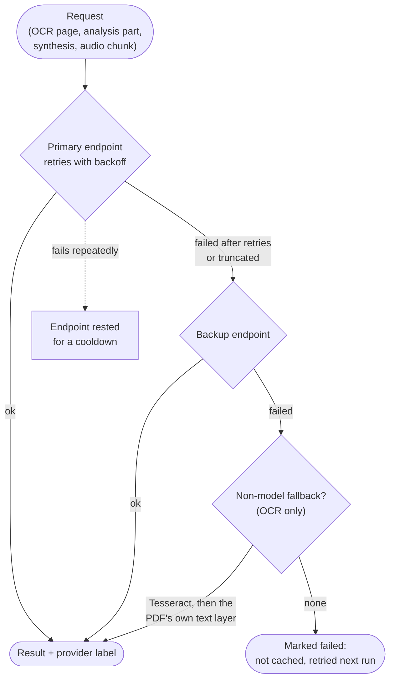

### Extract: from media to text

Documents and images become one text unit per page:

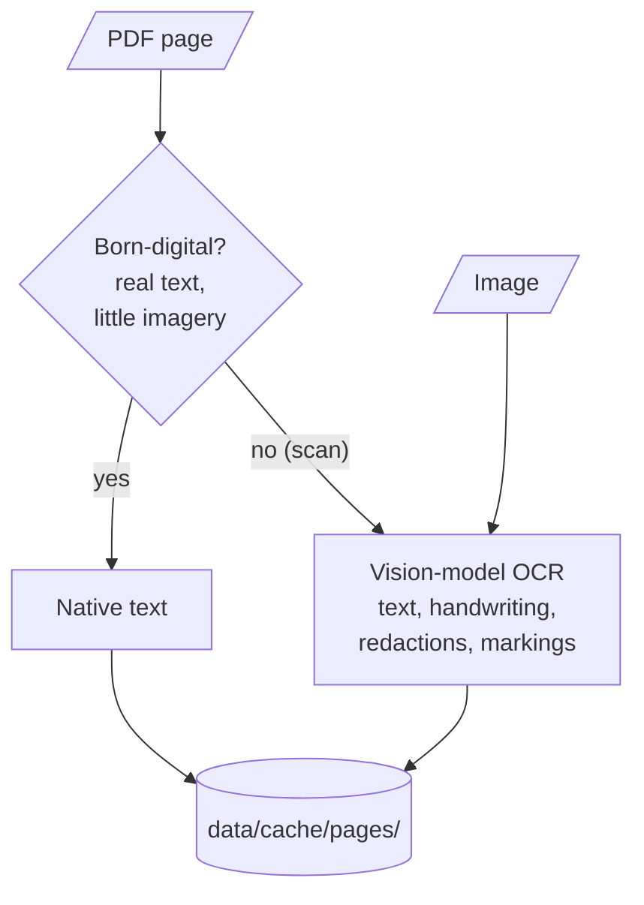

Video and audio become a frame description, a timed transcript and any published captions:

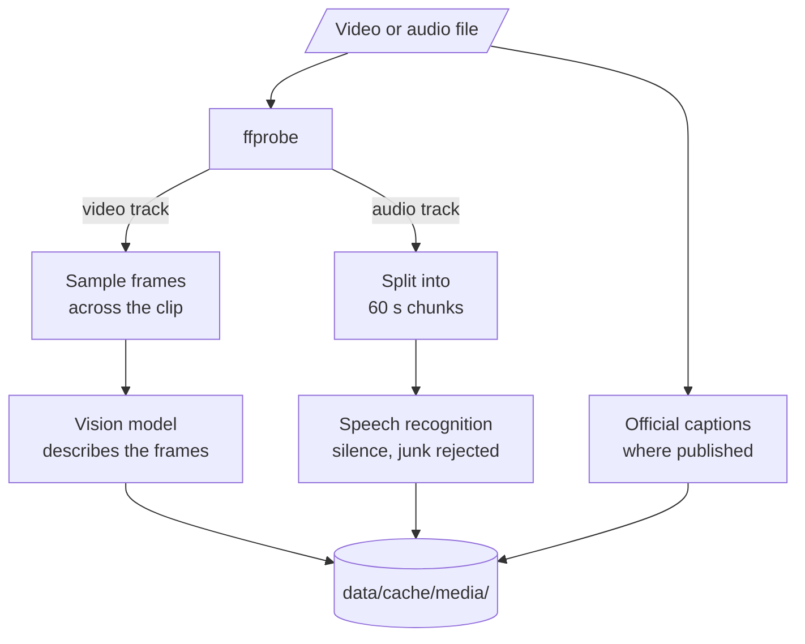

### Analyze: map over parts, reduce to a report

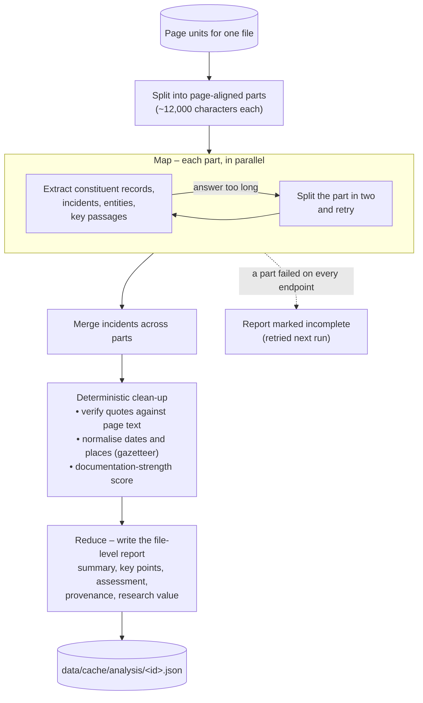

### Embed and build: linking and publishing

`embed` turns reports and incidents into vectors and stores two kinds of link:

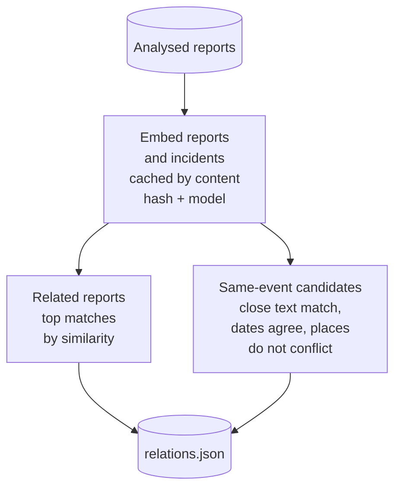

`build` applies the deterministic rules, groups accounts into events and writes the site:

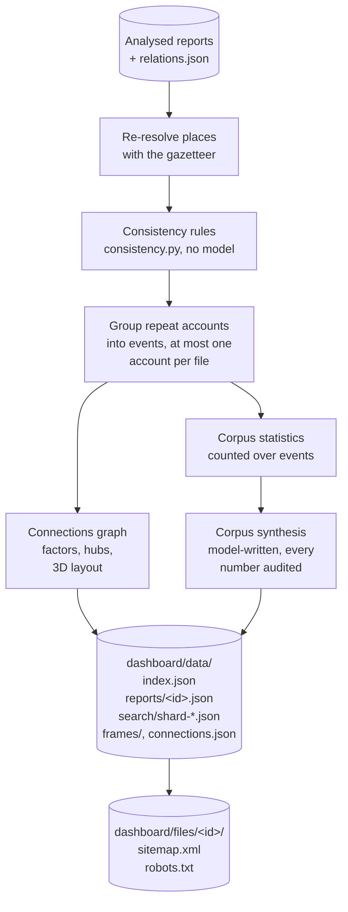

Before anything is written to the site, model names are replaced with the type of model (vision-language, speech-recognition or text-embedding model), and quotes that could not be matched to page text are hidden.

### How the front end loads data

The dashboard is hand-written HTML, CSS and JavaScript with no build step. It loads a compact index up front and everything else on demand:

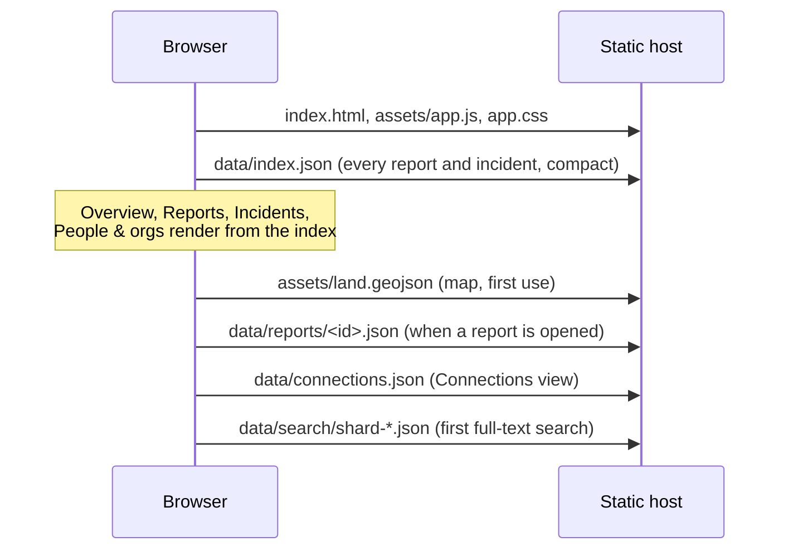

### Resumability and caching

Every stage is **resumable**. Results are cached by file content and settings, a failed page or part is never cached as if it had succeeded, and re-running a stage redoes only missing or failed work. Each result records which model or fallback produced it; the published dashboard shows only the type of model, never the specific model name, per page and per report. A summary of the last run – per-stage results, preflight status and model usage – is written to `data/cache/run_issues.json`.

## Setup

```sh
python3 -m venv .venv
source .venv/bin/activate
pip install -r requirements.txt
brew install ffmpeg tesseract        # macOS; required for video/audio and the OCR fallback
cp .env.example .env                 # then fill in endpoints and keys
```

### Model configuration (`.env`)

The pipeline uses three types of model, all served through OpenAI-compatible APIs: **vision-language models** (multimodal LLMs) for OCR, analysis and report writing, a **speech-recognition model** for audio transcription, and a **text-embedding model** for linking related reports. Any models of these types can be configured. Exported environment variables take precedence over `.env`.

| Variable | Role |
|---|---|
| `REMOTE_UFO_REVIEW_BASE_URL`, `REMOTE_UFO_REVIEW_API_KEY`, `REMOTE_UFO_REVIEW_MODEL` | Primary model for OCR, analysis and report generation (OpenAI-compatible, vision-capable). |
| `REMOTE_UFO_AUDIO_TRANSCRIPT_MODEL` | Remote backup for audio transcription. Optional. |
| `LOCAL_UFO_REVIEW_BASE_URL`, `LOCAL_UFO_REVIEW_API_KEY` | Local OpenAI-compatible server. |
| `LOCAL_UFO_REVIEW_MODEL` | Local backup for OCR and analysis. Optional but recommended. |
| `LOCAL_UFO_AUDIO_TRANSCRIPT_MODEL` | Primary audio transcription model (local). |
| `LOCAL_UFO_EMBEDDING_MODEL` | Embedding model (local). `LOCAL_UFO_EMBEDDING_BASE_URL` and `LOCAL_UFO_EMBEDDING_API_KEY` optionally point it at a different server. |
| `REMOTE_UFO_OCR_PARAMS`, `REMOTE_UFO_EXTRACT_PARAMS`, `REMOTE_UFO_SYNTHESIS_PARAMS` | Optional JSON merged into the request for each task, e.g. to switch off hidden reasoning for transcription. If the server rejects them the request is retried without. |
| `UFO_OCR_CONCURRENCY`, `UFO_EXTRACT_DOCUMENTS`, `UFO_ANALYSIS_CONCURRENCY`, `UFO_REQUEST_TIMEOUT` | Optional tuning: concurrent OCR pages, documents extracted at once, concurrent analysis parts, request timeout in seconds. |
| `UFO_SITE_URL` | Public base URL used for canonical links, the sitemap and `robots.txt`. |

A preflight check runs before any stage. It verifies `ffmpeg`, `ffprobe`, `tesseract` and every configured endpoint and model, stops if a stage could not produce valid output, and warns when a backup is unavailable:

```sh
python -m ufo_pipeline check
```

## Running

```sh
python -m ufo_pipeline all        # download + extract + analyze + embed + build
python -m ufo_pipeline process    # everything except download
tools/update_dashboard.sh         # download, then process (continues if some downloads fail)
```

Individual stages: `download`, `extract`, `analyze`, `embed`, `build`. `export-d1` rewrites the [MCP server](#mcp-server)'s database file from the built site.

Useful options:

| Option | Purpose |
|---|---|
| `--only TEXT` | Only sources whose filename contains TEXT (repeatable). |
| `--limit N`, `--page-limit N` | Scratch runs on a subset. |
| `--force` | Ignore caches for the selected stage and sources. |
| `--site-dir DIR` | Write the site somewhere else. Required for partial builds – a subset is never published into `dashboard/`. |
| `--data-dir DIR`, `--env-file FILE` | Use another data directory or `.env` file. |
| `--no-corpus-summary` | Skip the model-written corpus synthesis in `build` (the cached one is reused). |
| `--media-types LIST` | `download`: only these media types (default `pdf,image,video,audio`). |
| `--overwrite` | `download`: re-download files that already exist. |
| `--prune-orphans` | `download`: move files that are not in the manifest to `data/orphaned/`. |

A full first run over the whole corpus is long (many hours): it is bounded by how fast the remote model generates text. It can be interrupted and restarted at any time.

Scratch build of a few files:

```sh
python -m ufo_pipeline process --only CIA-UAP-D027 --only DOW-UAP-PR055 --site-dir data/scratch-site
cp -R dashboard/index.html dashboard/favicon.svg dashboard/assets data/scratch-site/
python3 -m http.server 8766 --directory data/scratch-site
```

## Viewing and deploying

The site loads its data with `fetch`, so serve the folder rather than opening the file directly:

```sh
python3 -m http.server 8000 --directory dashboard
```

Publishing is two steps: refresh the data, then deploy. Cloudflare does not run the pipeline; it serves what was built here.

```sh
tools/update_dashboard.sh         # download new files and rebuild
tools/deploy.sh                   # publish the dashboard, the MCP database and the MCP server
```

`tools/deploy.sh` deploys the dashboard (Cloudflare Workers Static Assets, `wrangler.toml`), reloads the [MCP server](#mcp-server)'s database when the data has changed, and deploys the MCP server. `--dry-run` runs every check and builds both Workers without publishing anything; `--force-data` reloads the database even when the data is unchanged. To publish the dashboard alone, run `npx wrangler deploy`.

## MCP server

The same data is available to AI agents through a [Model Context Protocol](https://modelcontextprotocol.io/) server at `https://ufo-analysis.rittmuller.com/mcp`. It is read-only, needs no account, and answers from exactly what the dashboard shows (labels after the consistency rules, model names replaced by model types, unmatched quotes hidden).

```sh
claude mcp add --transport http ufo-files https://ufo-analysis.rittmuller.com/mcp
```

| Tool | What it returns |
|---|---|
| `corpus_overview` | Corpus statistics, release dates, the written synthesis and the notes needed to read every other answer. |
| `search_text` | Full-text search over every page and transcript, with snippet, page number and page URL. |
| `search_incidents` | Incidents by text and filters (year, country, shape, sensor, status in the record, machine explanation, Hynek class, documentation strength, distance from a point). One row per event unless repeats are asked for. |
| `get_incident` | One incident in full, with page-checked quotes, other accounts of the same event and linked incidents with the reason for each link. |
| `search_reports` | Released files by text and filters (agency, media, kind, disposition, theme, release). |
| `get_report` | One report in sections: summary, provenance, incidents, records, key passages, entities, related reports, media. |
| `get_pages` | The extracted source text of a report, page by page, to verify a claim before quoting it. |
| `find_entity` | A person, organisation, place, programme, piece of equipment or file number, and the reports that mention it. |

Answers are bounded (limits, paging, a character budget for page text) and keep the record's own conclusion (`status_in_record`) apart from the machine assessment (`machine_explanation`, `machine_assessment`).

### How it is built

`build` writes `data/mcp/d1.sql` from the finished site data (`python -m ufo_pipeline export-d1` rewrites it without a full build). That file loads into a Cloudflare D1 database with SQLite full-text indexes. The server is a separate Worker in `mcp/` (plain JavaScript, no dependencies, no build step) on the route `ufo-analysis.rittmuller.com/mcp*`, so it deploys independently of the dashboard.

The server is stateless and speaks both generations of the protocol on one endpoint: the 2026-07-28 revision (no handshake, `server/discover`) and the `initialize` handshake of 2025-11-25 and earlier.

### Deploying

`tools/deploy.sh` publishes the server together with the dashboard (see [Viewing and deploying](#viewing-and-deploying)). It rewrites `data/mcp/d1.sql` from the built site, loads it into the D1 database named in `mcp/wrangler.toml` if it differs from the last load, and deploys the Worker. The load drops and recreates the data tables, so tool calls fail for the minute or so it takes.

A new Cloudflare account needs its own database first: run `npx wrangler d1 create ufo-analysis` in `mcp/` and put the printed `database_id` in `mcp/wrangler.toml`.

To run it locally:

```sh
cd mcp
npx wrangler d1 execute ufo-analysis --local --file ../data/mcp/d1.sql
npx wrangler dev                          # http://localhost:8787/mcp
```

## Repository layout

| Path | Purpose |
|---|---|
| `ufo_pipeline/cli.py`, `config.py` | Command line, settings from `.env`, preflight check. |
| `ufo_pipeline/download.py` | Stage 1: manifest and source downloads. |
| `ufo_pipeline/extract.py` | Stage 2: OCR, video frame review, audio transcription. |
| `ufo_pipeline/analyze.py` | Stage 3: per-file deep reports. |
| `ufo_pipeline/embed.py` | Stage 4: embeddings, related reports, same-event links. |
| `ufo_pipeline/site.py` | Stage 5: site data, corpus statistics and synthesis. |
| `ufo_pipeline/consistency.py` | Deterministic label rules applied at build. |
| `ufo_pipeline/connections.py` | Event grouping and the Connections graph and layout. |
| `ufo_pipeline/pages.py` | Static per-report HTML pages under `/files/`. |
| `ufo_pipeline/d1_export.py` | SQL export of the built site data for the MCP server's database. |
| `ufo_pipeline/llm.py`, `geo.py`, `util.py` | Model client and fallback chains, place resolution, shared helpers. |
| `dashboard/index.html`, `dashboard/assets/` | Hand-written front end (no build step). `app.js` is the overview and explorers, `report.js` the deep-report view, `connections.js` the 3D network. |
| `dashboard/data/`, `dashboard/files/` | Generated site data and static report pages. Ignored by Git; produced by `build`. |
| `mcp/` | The MCP server: `wrangler.toml`, and `src/` with the protocol layer (`index.js`), tools and SQL (`tools.js`), request accounting (`limits.js`) and search-query handling (`fts.js`). |
| `data/sources/` | Downloaded source media. Ignored by Git. |
| `data/mcp/d1.sql` | Database load file for the MCP server, written by `build`. |
| `data/processed/source_manifest.json` | Source manifest with checksums. |
| `data/cache/` | Stage caches (`pages/`, `media/`, `analysis/`, `embeddings.json`, `relations.json`, `corpus_summary.json`) and `run_issues.json`, the report of the last run. |
| `docs/screenshots/` | Images used in this README. |
| `tools/update_dashboard.sh` | One-command refresh. |
| `tools/deploy.sh` | One-command publish of the dashboard and the MCP server. |

## What the reports contain

The report design follows what UAP researchers, archivists and FOIA practitioners ask of a record:

- **Three kinds of date kept apart** – incident date, document date and release date.
- **Incident facts** modelled on the Air Force's own reporting format (AFR 200-2): time and duration, observer location, witnesses and their role, manner of observation and sensors, object description, weather, official action.
- **The record's conclusion vs. the analyst assessment**, always shown separately. Candidate conventional explanations carry supporting and contradicting evidence and an intelligence-community likelihood band.
- **Standard scales** – Hynek class, Vallée class and SVP rating, NATO Admiralty source-reliability and information-credibility codes (rated separately).
- **Documentation strength** – a transparent, computed 0–100 score for how well an incident is documented (sensing, witnesses, specificity, documentation). It is not a measure of how anomalous the event is.
- **Provenance** – originating office, file numbers, classification markings as printed, declassification, redaction level and exemption codes, items referenced but missing.
- **Verification** – every quote is labelled as an exact match, close match or not found in the page text; every page shows how its text was obtained.
- **Consistency rules** (`ufo_pipeline/consistency.py`, applied at build, no model involved) – an incident is "unidentified" only where the record states that conclusion or the publisher designates the case unresolved, otherwise "no evaluation in the record"; a Hynek class must agree with the recorded light and sensors; camera default timestamps (12/31/99) are not dates; a likelihood is shown only for a named explanation; model coordinates that match coordinates printed in the record are "stated"; a file that bundles incidents is labelled as containing incidents rather than given one disposition.
- **Repeat accounts** – the same event reported in several files is listed once per file but counted once on the overview (close text match, agreeing dates, non-conflicting places, at most one account per file). The count of distinct incidents is an estimate.
- **Connections** – incidents are linked only by named factors: same day within 150 km; the same specific shape and colour within 7 days and 800 km; the same event in another file; a shared named person; the same spacecraft mission or vessel. People and missions are hub nodes, and clusters are formed from incident-to-incident links only.
- **Map positions** – *confirmed* (named place found in the gazetteer, or coordinates printed in the record), *estimated* (the model's approximate coordinates, checked only against the stated state or country) or a state/country centroid; each is drawn differently.
- **Corpus synthesis check** – the build logs every number in the model-written overview that is not a corpus statistic (`unverified_numbers` in `data/cache/corpus_summary.json`). Review those before deploying.

"Unexplained in the record" means the file offers no resolution. It does not mean the event is anomalous.

## Data and publishing notes

- `data/` is ignored by Git; the full source corpus is tens of gigabytes.
- `dashboard/data/` and `dashboard/files/` contain the generated analysis and extracted page text. Review them before publishing.
- `dashboard/scientific-analysis.html` is a redirect stub for an old URL; the analysis it held is now part of the main dashboard.
- Directories from the previous pipeline (`data/ocr_markdown/`, `data/processed/documents/`, `data/processed/page_text/`, `data/processed/transcripts/`, `data/reviewed/`) are no longer read and can be deleted.

## License

See [LICENSE](LICENSE).
